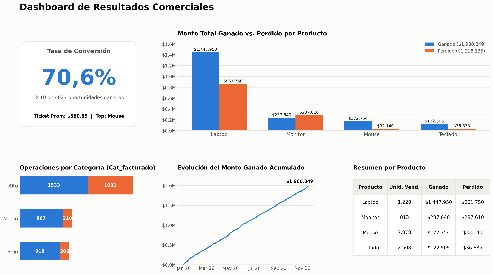

# Análisis de Desempeño Comercial y Dashboard Ejecutivo en Python

Pipeline completo de extracción, limpieza de datos (ETL), ingeniería de características y visualización ejecutiva desarrollado íntegramente en Python sobre un conjunto de **5.000 operaciones comerciales** (enero – noviembre 2026).

## Resumen Ejecutivo y Métricas Clave

Tras depurar el conjunto de datos original (**5.000 registros iniciales** → **4.827 registros válidos** tras eliminar valores ausentes, duplicados exactos e inconsistencias numéricas), se obtuvieron los siguientes indicadores principales:

| Indicador | Resultado | Criterio Aplicado |
| :--- | :---: | :--- |
| **Total Ganado** | **$1.980.849** | Suma de `monto_total` en operaciones con estado `Ganado` |
| **Total Perdido** | **$1.218.135** | Suma de `monto_total` en operaciones con estado `Perdido` |
| **Ticket Promedio** | **$580,89** | Promedio de facturación por venta concretada |
| **Tasa de Conversión** | **70,6%** | Porcentaje de oportunidades ganadas sobre el total válido |
| **Producto Más Vendido** | **Mouse** | Líder en volumen de unidades vendidas concretadas |

## Etapas del Proyecto

1. **Preprocesamiento y Calidad de Datos (ETL):** Auditoría de valores nulos, detección y eliminación de registros duplicados exactos y filtrado de inconsistencias comerciales (`Cantidad <= 0` o `PrecioUnitario <= 0`), descartando 173 registros anómalos.
2. **Ingeniería de Variables:**
   * `monto_total`: cálculo del importe facturado por operación (`Cantidad * PrecioUnitario`).
   * `Cat_facturado`: segmentación objetiva de las transacciones en niveles **Bajo**, **Medio** y **Alto** utilizando los percentiles 25 (Q1) y 50 (mediana) de la distribución empírica para evitar sesgos por valores extremos.
3. **Visualización Ejecutiva en Matplotlib:** Construcción de un dashboard multipanel sin herramientas externas de BI, integrando tarjeta KPI, comparación de ingresos ganados vs. perdidos por producto, distribución por categoría de facturación, evolución acumulada en el tiempo y tabla resumen.

## Principales Hallazgos

* **Diferencia entre volumen y facturación:** Mientras **Mouse** lidera ampliamente en cantidad de unidades vendidas con alta tasa de cierre, **Laptop** concentra la mayor parte de la recaudación total del negocio.
* **Oportunidad de mejora en tickets altos:** El cruce entre `Cat_facturado` y el estado de cierre muestra que el grueso del monto perdido se concentra en operaciones de ticket elevado (especialmente en **Monitor**), señalando un foco claro para optimizar el seguimiento comercial en propuestas de alto valor.

## Estructura del Repositorio

* `analisis_ventas_comerciales.ipynb`: Notebook con el código completo, limpieza, cálculos y generación del dashboard.
* `ventas_comerciales_5000.csv`: Dataset transaccional utilizado (separado por `;`).
* `dashboard_resultados.png`: Exportación en alta resolución (300 DPI) del tablero final.

## Stack Tecnológico

* **Python 3**
* **Pandas & NumPy** (manipulación, limpieza y agregación de datos)
* **Matplotlib** (diseño y renderizado del dashboard ejecutivo)
